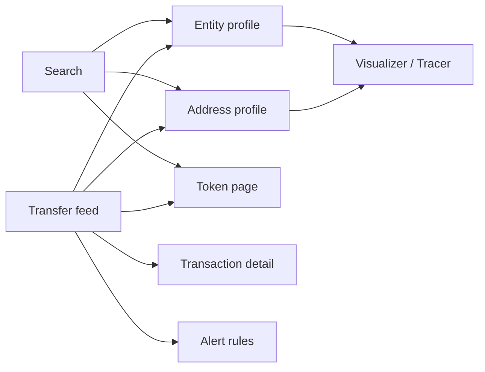

# Arkham Intelligence: public-site reverse engineering

Observed on 19 October 2026 at [arkm.com](https://arkm.com/). This is an analysis of the public interface and Arkham's published documentation. It does not include private code, authenticated flows, or verified internal API traffic.

## Product model

Arkham is an entity-first blockchain intelligence product. It maps blockchain **addresses** to human-readable **labels** and groups related addresses under an **entity**. Users start with search or a transfer, then move to an entity, address, transaction, or token page. Arkham's [API guide](https://arkm.com/api/docs) describes entity-first, confidence-scored attribution; its [platform guide](https://codex.arkm.com/the-intelligence-platform) lists portfolio, balance history, profit and loss, exchange usage, counterparties, and transaction history.

## Observed homepage

At a 1680 × 905 desktop viewport, the page uses an almost black canvas, compact white and gray typography, thin dark borders, muted blue highlights, and dense data panels. The top bar contains the Arkham logo, Predictions, Tracer, Visualizer, Alerts, Labels, API, More, compact search, Log in, Sign up for free, language, and settings. A large centered **ARKHAM INTELLIGENCE** heading and search trigger precede a two-column dashboard.

| Region | Visible content | Main interaction |
| --- | --- | --- |
| Trending Entities | Horizontal cards with entity name, USD holdings, change, largest holding, and active wallet count | Carousel arrows; card links to `/explorer/entity/{slug}` |
| All Transfers | Tall table with chain, time, from, to, value, token, and USD | Chain/time/from/to/value/token/USD filters, sorting, refresh, pagination, links to transaction, address, entity, and token pages |
| Top Bettors | Bettor ranking, bet count, win rate, 7-day PNL, ROI, and position rows | Carousel arrows; bettor link |
| Token Explorer | Token price, time-window changes, volume, market cap, supply, highs/lows | Carousel arrows; token explorer link and alert action |
| Footer | Codex, API docs, support, terms, privacy | Outbound links |

The transfer table displayed a default `USD >= $1` filter, 23 rows per page, a page counter, and sort controls for time, value, and USD. “Create Alert”, “Apply Filter”, “Save Preset”, “Copy”, and “Export” appeared disabled in the unauthenticated view. The footer and cookie dialog were visible. Holdings and transfer values are live data and should be treated as time-dependent, not design constants. These details came from the live page's accessibility tree and screenshot; the [public homepage](https://arkm.com/) corroborates its major sections and links.

The older [Codex homepage article](https://codex.arkm.com/the-intelligence-platform/homepage) describes a different dashboard composition. Use the live page as the reference for a current visual recreation; use Codex to understand concepts and deeper flows.

## Public navigation and data relationships

Observed links included `/explorer/entity/{slug}`, `/explorer/address/{address}`, `/explorer/token/{slug}`, and `/explorer/tx/{hash}`, plus `/predictions`, `/tracer_v2`, `/visualizer`, `/alerts`, `/labels`, `/api`, `/login`, and `/register`. These are public route shapes, not a claim about the site's routing framework.

The principal records needed for a recreation are:

| Record | Core fields visible or documented |
| --- | --- |
| Entity | Slug, display name, associated addresses, portfolio USD, percent change, largest holding, wallet count |
| Address | Chain, address, optional label, optional entity, balances and transfers |
| Transfer | Chain, transaction hash, timestamp, sender, recipient, token, amount, USD value |
| Token | Slug/symbol, current price, historical changes, volume, market cap, supply, all-time high/low |
| Alert | Sender/recipient or entity, token, amount/USD threshold, chain, notification channel |

Arkham's [Profiler documentation](https://codex.arkm.com/the-intelligence-platform/profiler) describes entity/address portfolio, historical performance, counterparties, borrowing, and transactions. [Token pages](https://codex.arkm.com/the-intelligence-platform/token-pages) add market data, holders, flows, and a token-specific transaction log. [Private labels](https://codex.arkm.com/the-intelligence-platform/private-labels) let users override displayed address labels and group addresses into private entities.

## Core investigative flows

1. **Search to profile:** Search supports entities, addresses, tokens, and other identifiers. Selecting a result opens a profile or token page. [Codex search guide](https://codex.arkm.com/the-intelligence-platform/homepage).
2. **Transfer to context:** A feed row links its time to transaction detail, its parties to addresses or entities, and its asset to a token page. Table filters narrow by chain, time, party, amount, token, or USD value.
3. **Profile to relationship graph:** [Visualizer](https://codex.arkm.com/the-intelligence-platform/visualizer) plots selected entities/addresses as nodes and transfers as edges, with filters and a time window. [Tracer](https://codex.arkm.com/the-intelligence-platform/tracer) follows counterparties and fund flows through an expandable graph.
4. **Monitoring:** [Alerts](https://codex.arkm.com/the-intelligence-platform/alerts) turn transfer filters into notifications via email, Telegram, or webhook.

## Reconstruction approach

For a local recreation, build the homepage first as a responsive dashboard with four independent data panels. Use a shared transfer model for table rows, profile links, and alert filters. Keep search, filter state, sort state, and pagination in the URL so a view can be shared. Poll or stream transfer updates only when a real data source is available; static sample rows should be labeled as examples. Treat login-gated controls as explicit states. Profile, token, graph, and alert pages can then reuse the same entity, address, token, and transfer records.

The visual hierarchy depends on the large empty space below the top bar, a centered search, then dense two-column data. Approximate screenshot-derived colors are background `#0b0c12`, panels `#111219` to `#171820`, border `#252631`, text `#f5f5f7`, muted text `#8d909d`, and accent blue near `#4777bd`. These are visual estimates, not extracted design tokens.

## Evidence boundary and unknowns

- Direct observations: homepage screenshot and accessibility tree in the browser, including visible routes and control states.
- Published descriptions: the linked Arkham Codex and API guide. Some Codex pages are older than the current UI.
- Inferences: normalized records and recommended implementation structure above.
- Unknown: frontend framework, precise CSS tokens, network endpoint shapes, update transport, authentication implementation, ranking algorithms, attribution logic, and behavior behind login. A fresh browser request entered Cloudflare security verification, and a direct HTML request returned HTTP 403, so neither bundle nor network inspection was verified. No claim here relies on bypassing that boundary.
